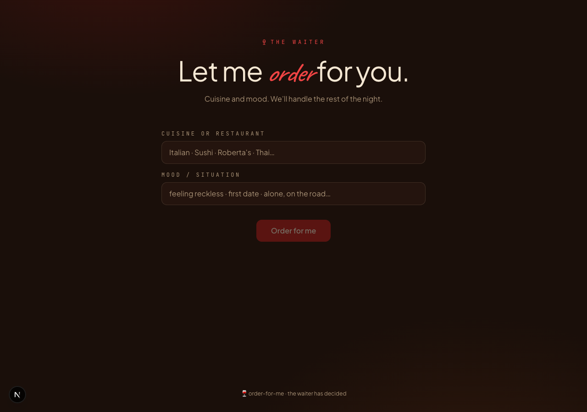

# 🍷 Order for Me

> Let me order for you.

Tell us the cuisine (or restaurant) and your mood for the night. AI orders the full meal — drink, opener, main, optional side or dessert — with one short reason for each pick. Renders as a handwritten waiter&rsquo;s notepad you can save.

## Stack

- Next.js 15 · App Router · TypeScript
- Tailwind CSS v4 (`@theme`)
- OpenAI `gpt-4o`
- `html-to-image`
- Framer Motion · lucide-react
- Caveat · Plus Jakarta Sans · JetBrains Mono

## Setup

```bash
pnpm install
cp .env.example .env.local
# add your OPENAI_API_KEY
pnpm dev
```

Open http://localhost:3000.

## License

MIT


